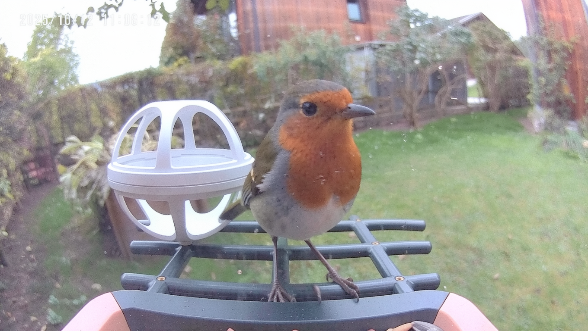
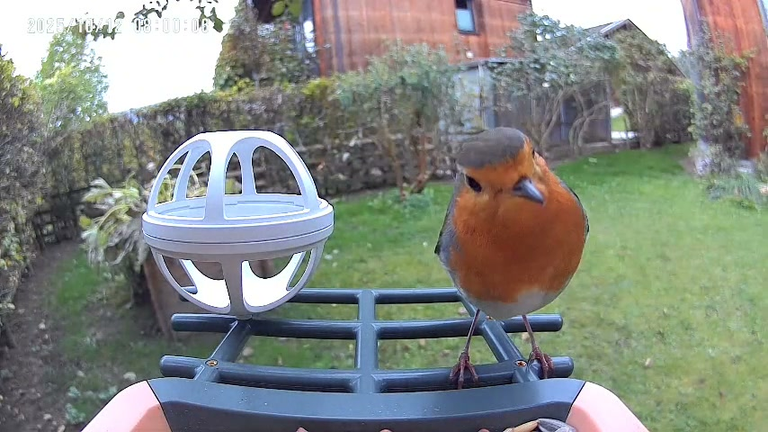
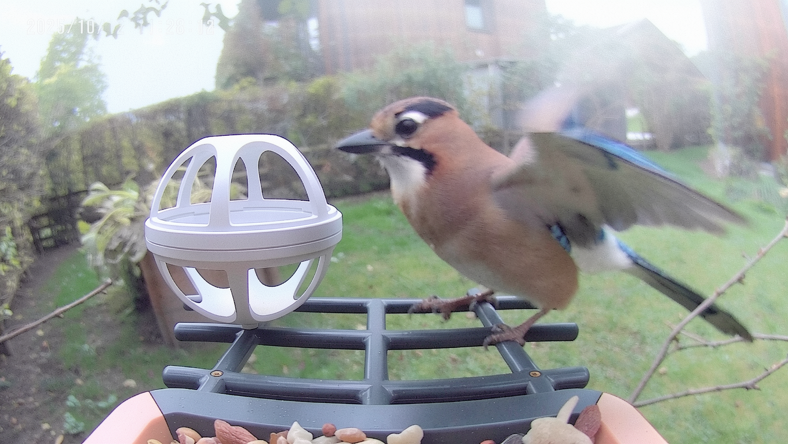
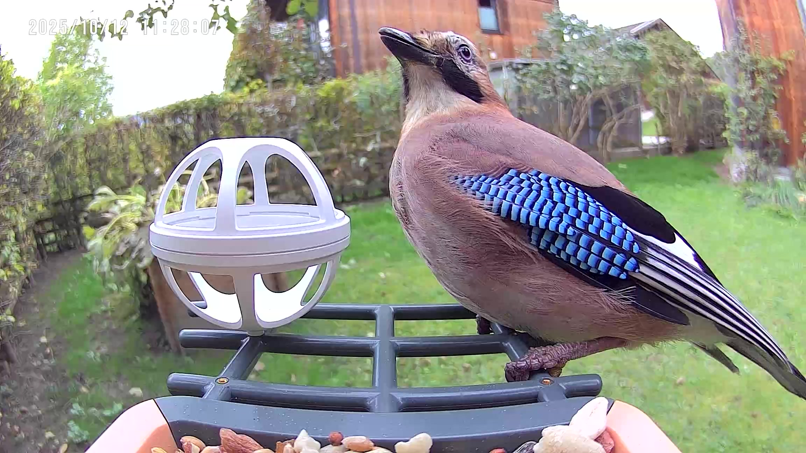
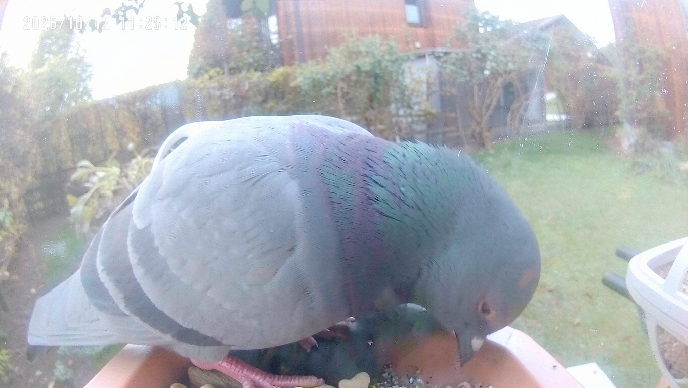
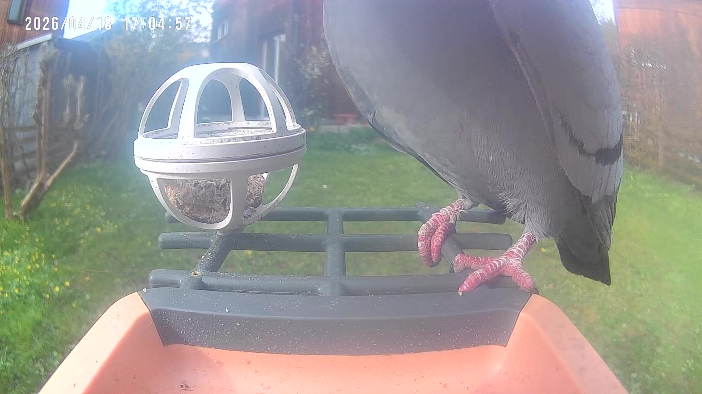
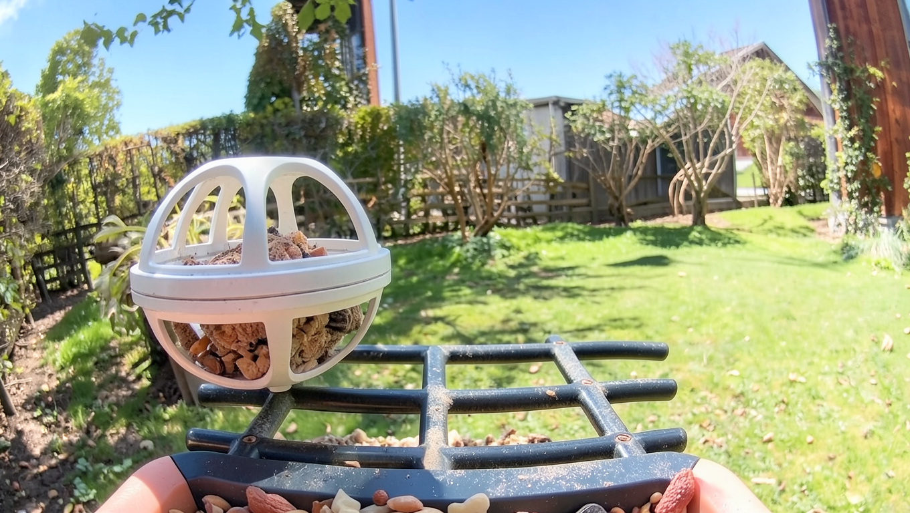

# Bird Feeder Classifier: Real Data with Synthetic Class Extension

Tools for preparing a bird-feeder-camera dataset and training bird-species classifiers.

## What it does

This project classifies bird species from fixed bird-feeder-camera footage. Its primary
11-class model is trained on labelled real feeder-camera images. A second, extended
14-class model uses the same real-data core and adds three rarely observed species with
synthetic training data: blackbird (`Amsel`), European greenfinch (`Gruenfink`), and
European goldfinch (`Stieglitz`).

This lets the classifier grow beyond the species that were observed often enough to
form a conventional real-image training set, without treating synthetic data as a
replacement for the well-covered real classes.

## Synthetic data for rare-class extension

Synthetic samples are generated with
[FLUX.2 Klein 4B](https://huggingface.co/black-forest-labs/FLUX.2-klein-4b-fp8).
Generation prompts are randomized for every sample to create distinct variations
in pose, framing, lighting, weather, and camera artefacts.

No real test images were used as inputs or references during synthetic-data
generation. The held-out real test set remains separate from the synthetic training
pipeline.

Many general bird-image datasets contain clean, well-composed wildlife photographs.
In contrast, fixed bird-feeder cameras produce a much less controlled visual domain:
nearby birds can appear disproportionately large because of the lens, the lens can be
obscured by rain, dirt, or smears, and birds may be partly cropped, viewed from behind,
or captured in otherwise atypical poses. The synthetic generation workflow is designed
to represent these conditions during training.

When collecting data from the intended feeder camera, it quickly became clear that
some species visit only rarely and therefore have too few real images for reliable
training. Synthetic generation provides a practical extension path: new species can be
added without first collecting a large real-image set. It also permits deliberate
coverage of rare but important conditions, such as late-night visits when the camera
activates night mode, severe weather, fog, or a dirty lens.

### Synthetic and real feeder-camera examples

The examples below illustrate the target domain: imperfect fixed-camera frames,
rather than clean wildlife photography. The synthetic set includes both bird and
empty-feeder (`No Bird`) examples.

| Class | Synthetic generation | Real feeder-camera frame |
| --- | --- | --- |
| European robin (`Rotkehlchen`) |  |  |
| Eurasian jay (`Eichelhäher`) |  |  |
| Common wood pigeon (`Taube`) |  |  |
| No bird |  | No real empty-frame labels are included in the current evaluation set. |

## Models and evaluation

| Checkpoint | Classes | Training data | Evaluation note |
| --- | --- | --- |
| Real-only ConvNeXt-Tiny | 11 established classes | Labelled real feeder-camera images | Primary deployment model; 94.8% on a 426-image held-out real-image test split. |
| Combined ConvNeXt-Tiny | Same 11 established classes | Labelled real feeder-camera images plus synthetic images | 93.4% on the same 426-image held-out real-image test split; retained as a direct synthetic-augmentation comparison. |
| Synthetic-only ConvNeXt-Tiny | Same 11 established classes | Synthetic images only | 60.1% on the same 426-image held-out real-image test split; direct estimate of synthetic-to-real transfer. |
| Extended ConvNeXt-Tiny | Core 11 + Amsel, Gruenfink, Stieglitz | Real images for the core classes; synthetic-only training for the three additions | All available real images of the three additions are held out for testing. |

In the current experiments, synthetic augmentation did not improve the well-covered
11-class core: the real-only model achieved 94.8% versus 93.4% for the combined
model. Its present value is therefore class extension—making it possible to include
rare species that do not yet have enough real images for conventional training.

The extended model's three synthetic additions should not be summarised by a single
headline accuracy yet: their real test sets contain only 7 blackbird, 30 greenfinch,
and 5 goldfinch images. Those counts are too small for a stable species-level accuracy
estimate.

The synthetic-only 11-class baseline achieved 99.1% on its synthetic validation set
but only 60.1% against held-out real images. This large difference directly measures
the remaining synthetic-to-real domain gap: generated feeder-camera frames are useful
for extending the label space, but they do not yet substitute for real examples of
well-covered species. The result keeps the synthetic-data question measurable without
overstating performance for the three rare extension classes. The small synthetic
Tannenmeise set should be treated especially cautiously: it currently contains only
six images in total.

These results are a proof of concept, not a claim of broad real-world generalisation.
The training data is still intentionally biased toward the feeder, viewpoint, and
surrounding environment in which deployment is planned; this should provide the best
accuracy for that specific scenario. The synthetic workflow can, however, be adjusted
to use more varied backgrounds and camera placements when the aim is to generalise to
other feeders or locations.

## How to use it

### Development environment

Create and activate a dedicated Conda environment, then install the project in editable mode:

```powershell
conda create -n bird-classifier python=3.11 pip
conda activate bird-classifier
pip install -e ".[dev]"
```

Install PyTorch separately using the command generated by the official PyTorch installer for the selected CPU or NVIDIA CUDA build.

### Extract candidate bird frames

Use the dedicated binary bird/no-bird model to inspect each video at up to four
strategic positions and save one likely-bird frame per video:

```powershell
python scripts/extract_bird_frames_from_videos.py --input-dir F:/VogelVideos --output-dir F:/video vogel
```

The output can be labelled in Label Studio. The local prediction backend and bulk
prediction script can pre-label tasks using the species classifier.

### Train a classifier

Train the primary real-only, 11-class deployment model:

```powershell
python -u scripts/train_classifier.py --data-source real --architecture convnext-tiny --class-set core --epochs 30 --batch-size 32 --num-workers 0
```

Train the extended model. The script uses real images only for the 11 core classes and
synthetic images only for Amsel, Gruenfink, and Stieglitz; every real image of those
three additions remains reserved for testing:

```powershell
python -u scripts/train_classifier.py --data-source combined --architecture convnext-tiny --class-set extended --epochs 30 --batch-size 32 --num-workers 0
```

For the core set, `--data-source real`, `synthetic`, or `combined` selects the desired
training source. Use `--architecture mobilenet-v3-large` for the mobile-oriented
alternative. A fixed, class-balanced real-image hold-out split is always reserved for
evaluation.

### Project layout

- `data/raw/`: original downloaded or collected data (not tracked by Git)
- `data/interim/`: intermediate cleaned data (not tracked by Git)
- `data/processed/`: finalized train/validation/test data (not tracked by Git)
- `src/bird_classifier/`: reusable application code
- `scripts/`: executable dataset and training entry points
- `configs/`: version-controlled training and dataset configuration
- `tests/`: automated tests
- `models/`: local model checkpoints (not tracked by Git)

## Status

The project includes synthetic-data generation workflows, Label Studio-assisted
labelling, bird-aware video-frame extraction, unified model training, and batch
prediction analysis. Further work should expand the real-world test set, particularly
with additional deployment locations and manually verified rare species.
