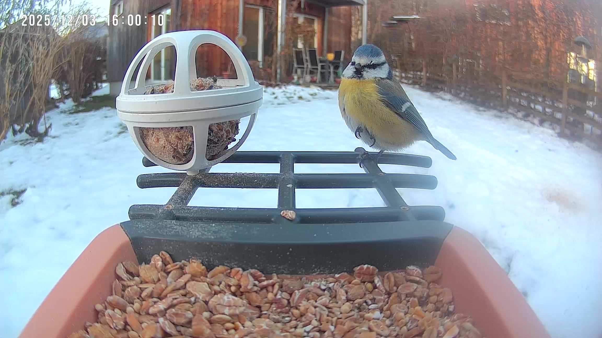
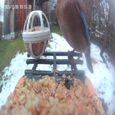
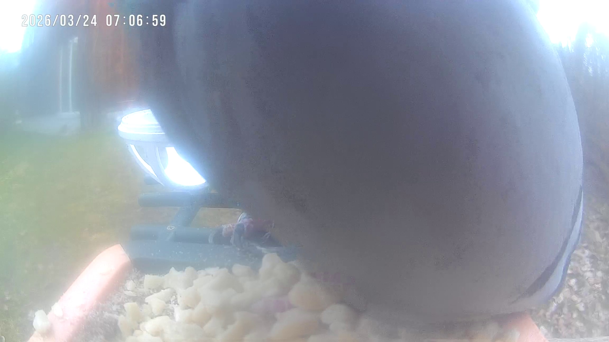

# Bird Feeder Species Classifier

A classifier for images and videos from a fixed bird-feeder camera. It predicts the
species visible in a frame, or `No Bird` for an empty feeder.

## Supported species

The primary model predicts these 11 classes:

| German | English |
| --- | --- |
| Blaumeise | Blue tit |
| Eichelhäher | Eurasian jay |
| Feldsperling | Eurasian tree sparrow |
| Kleiber | Eurasian nuthatch |
| Kohlmeise | Great tit |
| Rotkehlchen | European robin |
| Specht | Woodpecker |
| Sumpfmeise | Marsh tit |
| Tannenmeise | Coal tit |
| Taube | Common wood pigeon |
| Kein Vogel (`No Bird`) | No bird |

An extended model additionally predicts rare species using synthetic images: Amsel
(common blackbird), Grünfink (European greenfinch), and Stieglitz (European goldfinch).

## Accuracy

The first three models were tested on the **same 426 held-out real feeder-camera
images**, so their scores are directly comparable.

| Model | Training images | Test accuracy | Parameters / checkpoint | GitHub |
| --- | --- | --- | --- | --- |
| **ConvNeXt-Tiny** | Real core data | **94.8%** | 27.83M / 106.21 MiB | Too large for regular GitHub hosting |
| **MobileNetV3-Large** | Real core data | 91.5% | 4.22M / 16.27 MiB | Included |
| ConvNeXt-Tiny | Real + synthetic core data | 93.4% | 27.83M / ~106 MiB | Not included |
| ConvNeXt-Tiny | Synthetic core data only | 60.1% | 27.83M / ~106 MiB | Not included |
| Extended ConvNeXt-Tiny | Real core data + 3 synthetic classes | Not reliable yet | 27.83M / ~106 MiB | Not included |

ConvNeXt-Tiny provides the best core-class accuracy. MobileNetV3-Large is 3.3 percentage
points lower, but its much smaller checkpoint can be stored directly in GitHub. The
extended model adds common blackbird, European greenfinch, and European goldfinch, but
their real test sets are currently too small for a reliable headline score.

Synthetic data is used primarily to add rare species. No held-out real test image was
used to generate the synthetic training data.

The GitHub-hosted MobileNet checkpoint is available at
[`models/real_only_mobilenet_v3_large.pt`](models/real_only_mobilenet_v3_large.pt).

### Example predictions

These are four correctly classified images from the held-out real test set. Certainty
is the model's probability for its predicted class.

| Test image | ConvNeXt-Tiny prediction | MobileNetV3-Large prediction |
| --- | --- | --- |
|  | Blue tit (Blaumeise), 99.95% | Blue tit (Blaumeise), 99.22% |
|  | Eurasian jay (Eichelhäher), 99.95% | Eurasian jay (Eichelhäher), 100.00% |
|  | European robin (Rotkehlchen), 99.95% | European robin (Rotkehlchen), 100.00% |
|  | Common wood pigeon (Taube), 99.90% | Common wood pigeon (Taube), 100.00% |

## Train

```powershell
conda create -n bird-classifier python=3.11 pip
conda activate bird-classifier
pip install -e ".[dev]"
```

Train the primary 11-class model:

```powershell
python -u scripts/train_classifier.py --data-source real --architecture convnext-tiny --class-set core --epochs 30 --batch-size 32
```

Train the extended model:

```powershell
python -u scripts/train_classifier.py --data-source combined --architecture convnext-tiny --class-set extended --epochs 30 --batch-size 32
```

## Predict a folder

```powershell
python scripts/batch_predict_media_folder.py F:/BirdCamera/recordings --model F:/path/to/model.pt --recursive
```

The prediction report is saved as `bird_detection_report.json` in the input folder.
